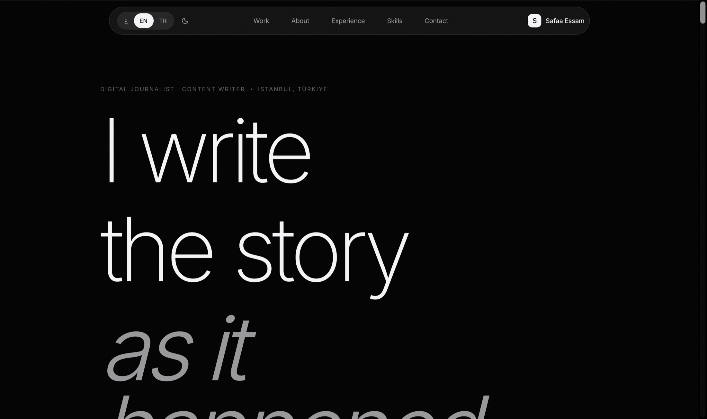
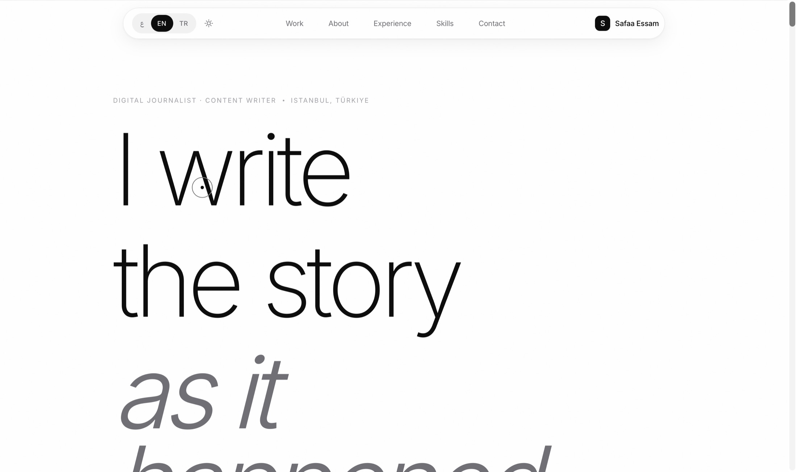
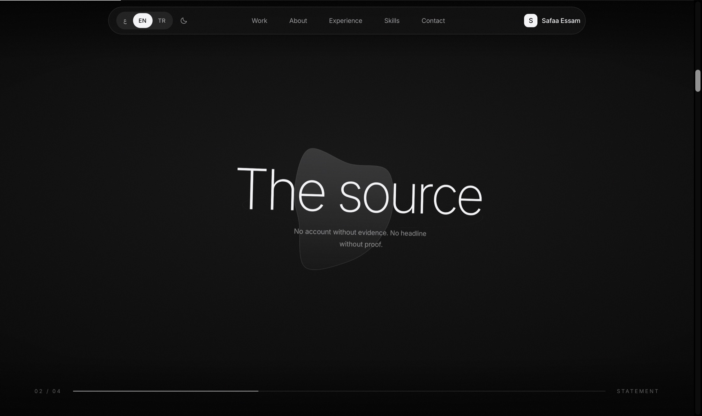
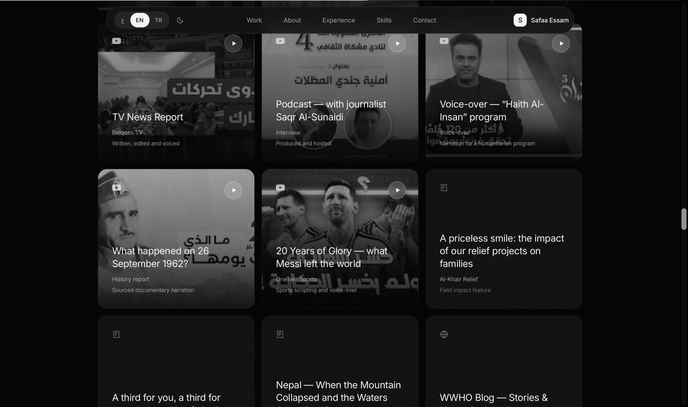
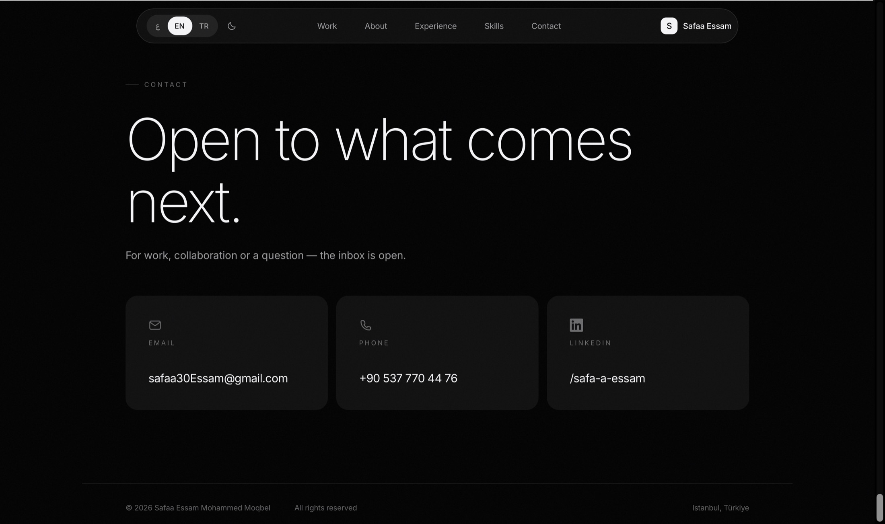

# Safaa Essam — Portfolio

A trilingual portfolio for a digital journalist: Arabic, English and Turkish,
with full RTL support, a time-aware theme, and a scroll-driven statement
sequence.

**Live → [safaa-essam-portfolio.web.app](https://safaa-essam-portfolio.web.app)**

No framework, no build step, no dependencies. Four JavaScript modules, one
stylesheet, and an `index.html` you can open from disk.

---



<table>
<tr>
<td width="50%"></td>
<td width="50%"></td>
</tr>
<tr>
<td width="50%"></td>
<td width="50%"></td>
</tr>
</table>

---

## What it does

| | |
|---|---|
| **Three languages** | Arabic, English, Turkish. Every string lives in `i18n.js`; switching rewrites the document, flips `dir`, re-renders the collections and re-splits the animated headlines. |
| **Real RTL** | Not a mirrored LTR layout. Arabic gets its own font stack, line heights, weights and letter-spacing, because the Latin display tricks actively damage it. |
| **Time-aware theme** | Light between 07:00 and 19:00 local, dark outside it. It keeps watching, so a page open at 18:58 turns over on its own. A manual press wins and is remembered. |
| **Scroll-driven sequence** | A four-shot statement section where scroll position *is* the transport — a 3D camera move, morphing geometry, and type that stretches with scroll velocity. Nothing runs on a timer, so it obeys the hand in both directions. |
| **31 linked works** | Broadcast, writing and campaign work, filterable, with live YouTube frames as covers. |

---

## Stack

Vanilla HTML, CSS and ES modules. Deployed on Firebase Hosting.

The only external resources are two Google Fonts (Inter, IBM Plex Sans Arabic)
and YouTube's thumbnail CDN. Everything else — the geometry, the easing, the
layout engine for the animated headlines — is in this repository.

```
public/
  index.html          markup + the pre-paint theme script
  css/style.css       one stylesheet, token-driven
  js/
    app.js            language, rendering, theme, header, filtering
    cinema.js         the scroll-scrubbed statement sequence
    data.js           every linked work
    i18n.js           every string, in three languages
  assets/             portrait
docs/screens/         the screenshots above
firebase.json         hosting config and cache policy
```

---

## Engineering notes

The parts that were not obvious.

### Scroll as transport, not as a trigger

The statement section is a 560vh runway with a sticky stage. Every value —
camera dolly, pan, tilt, per-shot depth, letter stretch — is derived from
scroll position each frame, not from a timeline that fires once on entry.

That choice is what makes it feel like scrubbing a video rather than watching
an animation: scroll back and it runs backwards; stop and it holds.

Two details make it read as a camera rather than a slider:

- the stage follows scroll through a damped lerp, so it trails the input slightly
- shot ranges overlap, so one is always arriving while another leaves — the cut
  never lands on an empty frame

### Arabic is a joining script

The headline animation splits text into units and animates each one. Splitting
to the **glyph** works in Latin and destroys Arabic: a letter's shape depends on
its neighbours, and giving each character its own box forces the isolated form
and severs every join.

Text containing Arabic is therefore split at the **word**, which is the smallest
unit that survives in both scripts. The same reasoning removed negative
letter-spacing from every Arabic heading — tightening pushes marks into the
neighbouring glyph.

### FLIP for the work grid

Toggling `display` makes surviving cards teleport to their new slots. Instead
the grid measures where every card is, changes the set, measures where each
card landed, and plays each one from its old position to its new one.

Re-entrancy is most of the difficulty: filters get clicked faster than the
sequence runs, so every pass cancels the previous one outright. An exit
animation left with `fill: forwards` outlives itself and pins `opacity: 0` onto
cards that later come back — which is how they disappear permanently.

### Browser chrome has to follow the page

`theme-color` is a single value for the whole document, but this page has
sections of different colours. Fixed to the theme, it left a mismatched band
above and below the page whenever the dark statement section was under the
edge of the screen.

It is now computed from *what is actually at the viewport edge*, updated on
scroll, and only written when the value changes. On iOS the meta element is
**replaced** rather than mutated, because changing `content` in place does not
reliably trigger a repaint.

The page also deliberately omits `viewport-fit=cover`. With it, the page
extends under the status bar and home indicator and becomes responsible for
painting them; without it, Safari insets the viewport and fills those strips
with the page background itself.

### Masks must not clip

Headlines rise out of an `overflow: hidden` line box. That box needs room on
both sides: Latin descenders below, and Arabic marks *above* — the hamza on أ,
the bar of ك. The mask is also removed once the line has arrived, so the
closing mark's pulse is not cut off at the edge.

### One rAF loop

The outlet marquee advances in a `requestAnimationFrame` loop. It was started
from three places — boot, `fonts.ready`, and every `resize` — and each call
started another loop while the previous kept running, all advancing the same
offset. iOS fires `resize` continuously as the address bar collapses, so the
strip accelerated as you scrolled. There is now exactly one loop; measurement
is separate from animation.

Its cycle width is measured from one repetition plus its gap, not
`scrollWidth / 3` — that does not divide evenly once gaps exist, and the
remainder showed up as a visible jump at every wrap.

### Graceful by default

If JavaScript fails or an observer never fires, the hero renders plainly rather
than staying masked. `prefers-reduced-motion` collapses the statement section
into a readable stack, stops the marquee and removes every entrance animation.

---

## Running it

```bash
cd public && python3 -m http.server 5173
# http://localhost:5173
```

No build, no install.

## Deploying

```bash
npm i -g firebase-tools
firebase login
firebase deploy --only hosting
```

Hosting serves HTML, CSS and JS with `no-cache` — the browser keeps them but
revalidates, so a deploy is visible immediately without clearing anything.
Images are immutable for a year.

## Editing content

- **Links and works** → `public/js/data.js`
- **Copy, in all three languages** → `public/js/i18n.js`
- **Experience and training** → the exported tables at the bottom of `i18n.js`

Adding a language means adding a key to `LANGS`, a direction to `DIR`, and a
block to `T`. Nothing else is language-aware.

---

## Credits

Content, journalism and media work — **Safaa Essam Mohammed Moqbel**
Design and development — **[Mohammed Alansi](https://github.com/Alansi775)**
